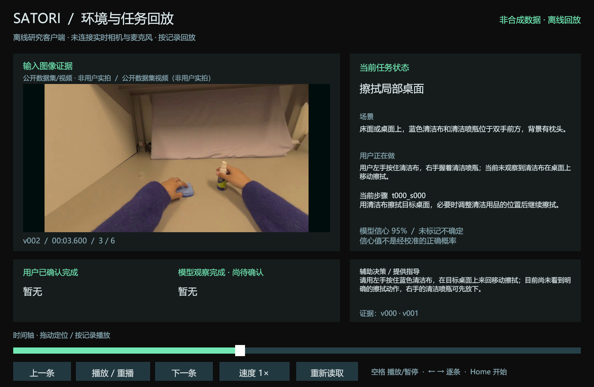
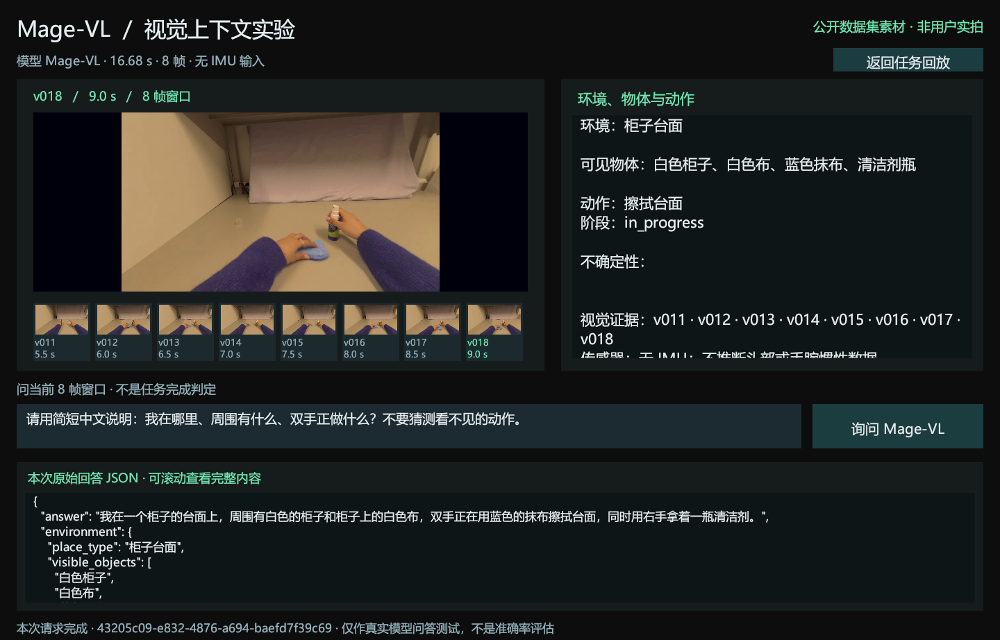

# Satori-Rokid

基于 Satori 思路的第一视角环境与任务理解研究原型，包含 **Unity 回放客户端、Python 方法后端、公开数据评测工具**。

当前已实现多帧观察、目标提议、下一步预测、进度检查、文字指导与缓存。工程正在向 Rokid 场景推进；本仓库尚未包含眼镜实时相机、语音和 IMU 接入，也尚未验证完整任务交互效果。

## Unity 运行界面

以下为2026年10月16日保存的Unity运行截图，输入画面来自 [Apple EgoDex](https://github.com/apple-aiml-research/ml-egodex) 公开视频，非眼镜实拍。截图来源与素材说明见 [图片说明](docs/images/README.md)。

### 任务状态与文字指导回放



回放真实模型运行记录：左侧展示观察帧，右侧展示任务、动作和当前步骤，下方区分用户确认与模型观察，并显示文字指导和证据。此时尚无用户确认完成的步骤；图中95%为模型自报置信值，不是实测准确率。

### Mage-VL 多帧环境问答



历史真实接口请求使用8帧窗口，界面展示输入缩略图、环境与动作描述，以及原始JSON。16.68秒是图中这一次请求的端到端耗时，输入不含IMU。回答保留模型原文，其中场景、物品和手部动作细节可能判断错误，不作为标准答案。

## 实验与结果

截至2026年10月18日，已完成以下公开数据实验和流程演示；10月20日补充了任务问答的语义重评分。总体上，模型对高层任务目标的识别较好，但较远未来的动作预测，以及涉及多人互动和反事实推理的问答仍有明显不足。

### 跑了哪些实验

| 实验 | 数据与规模 | 输入 | 评价内容 |
|---|---|---|---|
| 任务目标识别 | GTEA，28个视频、7类目标 | 整段视频均分4段，每段取中间1帧 | 用户在完成什么任务，Top-1准确率 |
| 未来动作预测 | GTEA，32个目标事件，0/1/3秒前瞻，共96题 | 目标动作开始前的4帧，每秒1帧，最后一帧早于动作起点 | 接下来发生什么动作，Top-1准确率 |
| 任务相关问答 | EgoTaskQA，200题、189个视频 | 整段视频均分4段各取中间1帧，加原始问题 | 人物、物体、动作与关系，字面匹配率（另补充语义重评分） |
| 环境与动作识别 | Charades-Ego，32段视频 | 整段视频均分8段，每段取中间1帧 | 场景识别与动作micro-F1 |
| Satori流程演示 | EgoDex清洁短片，6个采样时刻 | 每个时刻最近的1至4帧 | 环境理解、目标提议、预测、进度检查与指导生成 |

前三项为七模型主实验：每个模型324题，累计 **2268个模型—样本结果**，包含此前完成的Mage-VL与VideoChat3-4B结果。各模型看到相同的关键帧（按时间顺序、带时间戳的静态图片，不是连续视频）和问题，标准答案不进入模型请求；失败和弃答均保留在固定分母。

### 七模型主实验结果

| 模型 | 目标识别，28题 | 动作预测，96题 | 任务问答，200题（字面匹配） |
|---|---:|---:|---:|
| Claude Opus 5.5 | **89.29%（25/28）** | 55.21%（53/96） | **22.50%（45/200）** |
| GPT-6-astra | 67.86%（19/28） | **60.42%（58/96）** | 19.50%（39/200） |
| GPT-6.1-sol | **89.29%（25/28）** | 54.17%（52/96） | 17.50%（35/200） |
| GPT-5.6-sol | 67.86%（19/28） | 13.54%（13/96）* | 全部接口失败，无法评价 |
| Mage-VL | 53.57%（15/28） | 6.25%（6/96） | 2.00%（4/200） |
| VideoChat3-4B | 32.14%（9/28） | 5.21%（5/96） | 4.00%（8/200） |
| Dispider | 未获得合格输出 | 未获得合格输出 | 未获得合格输出 |

*GPT-5.6-sol动作预测有53次调用失败，问答200题全部接口失败；Dispider输出未满足本轮评分格式要求。这些结果不能直接解释为模型能力弱或视觉能力为零。Mage-VL和VideoChat3-4B也受到接口或输出格式问题影响。*

问答正式分数按统一大小写、标点、英文冠词和空白后的答案匹配率计算；另做了一次语义重评分作为补充，见下文“结果说明”。Claude实际使用high，GPT未显式指定推理档位；结果反映当前接入配置下的表现，内部推理预算未完全统一。GPT名称沿用第三方接口路由别名，底层权重未独立核验。

### 结果说明

**目标识别较好，但不代表任务早期就能识别意图。** Claude与GPT-6.1-sol均答对25/28个视频。这里的4帧覆盖完整视频，因此主要验证对整段任务的概括能力。

**提前越久预测动作，准确率越低。** 三条表现较好的API路由结果如下，每个时距均为答对题数/32；不同列共享同一组目标事件。

| 模型 | 0秒 | 提前1秒 | 提前3秒 |
|---|---:|---:|---:|
| Claude Opus 5.5 | 24/32 | 17/32 | 12/32 |
| GPT-6-astra | 29/32 | 18/32 | 11/32 |
| GPT-6.1-sol | 26/32 | 15/32 | 11/32 |

0秒条件的最后观察帧也早于目标动作起点。结果提示，紧接当前观察的动作判断与较远未来的意图预测需要分别评价。

**任务问答按字面评分明显偏低，真正的短板在多人互动和反事实推理。** 按字面匹配，问答最高22.50%，固定回答“no”的简单基线为18%；Claude在132道查询题中仅答对2题。逐题检查发现，查询题的标准答案使用数据集内部标签词（如 `bottle-water`、`watermelon1`、`poweredness`、`Turn off TV with remote`），意思正确的自由作答也会被判错。补充的语义重评分结果如下：

| 模型 | 字面匹配（正式） | 语义等价 | 含部分正确 |
|---|---:|---:|---:|
| Claude Opus 5.5 | 22.50%（45/200） | **36.50%（73/200）** | 40.00%（80/200） |
| GPT-6-astra | 19.50%（39/200） | 29.50%（59/200） | 34.00%（68/200） |
| GPT-6.1-sol | 17.50%（35/200） | 26.50%（53/200） | 31.00%（62/200） |
| Mage-VL | 2.00%（4/200） | 4.00%（8/200） | 8.00%（16/200） |
| VideoChat3-4B | 4.00%（8/200） | 6.00%（12/200） | 8.50%（17/200） |

提升全部来自查询题（Claude从2/132升到30/132），是非题不受影响。按意思评分后，数据集归为多人互动类的13道题，三个API模型仍全部答错；40道反事实题中，Claude也只从11题升到12题。判分由三个独立的Claude Haiku 5.5代理盲评，只比较答案文字的含义，不看视频。真实答案中三票完全一致的占92%（Fleiss κ 0.86），40个故意配错的对照答案无一被判为正确。这是看到结果后追加的补充分析，方法、复核与局限见 **[EgoTaskQA语义重评分](docs/egotaskqa-semantic-rescore.md)**。四帧观察可能缺少关键证据，但当前实验不能将低分全部归因于帧数。

### Charades-Ego环境与动作识别

这一组是独立的32段视频、每段8帧对比，不并入上面的2268个结果。

| 模型或基线 | 动作识别micro-F1 |
|---|---:|
| GPT-5.6-luna | **31.21%** |
| 固定训练频率基线 | 17.82% |
| Mage-VL | 16.42% |

GPT的动作F1较高，但动作召回率仍只有19.13%，漏检明显。在两模型都成功返回的28段视频上，场景识别均答对15段。因此，能识别大致场景并不等于能准确理解具体动作。

### Satori与Unity流程演示

真实清洁短片在6个采样时刻产生了15个阶段响应，跑通环境与行为理解、目标提议、下一步预测、进度检查、文字指导及缓存，结果可在Unity中回放。

最后步骤仍处于执行状态，尚未完成整项任务，也没有独立步骤标签可用于计算准确率。该演示验证流程可运行；完整任务交互、真实眼镜传感器融合与主动提示效果仍需后续实验。

### 当前结论与下一步

目前完成了 **Satori方法原型、Unity回放展示与公开数据模块benchmark**，尚未完全对齐原论文评测协议，也不属于官方榜单结果。下一步优先补齐完整任务交互和独立步骤标注，再固定模型与其他设置，比较时序窗口、事件记忆及预取对准确率和等待时间的影响。

单独阅读版本见 **[实验简报](docs/experiments.md)**。

## 环境

- Unity：开发与验证版本为 **2022.3.62f3c1**，记录在 `ProjectSettings/ProjectVersion.txt`。
- Python：**3.12 或以上**；依赖锁定在 `Research/Backend/uv.lock`。
- 离线演示不需要眼镜、GPU或模型密钥。
- 本仓库包含 MCP for Unity 编辑器包。模型权重、公开视频、实验原始响应和机器配置需另外准备。

## 运行后端离线演示

安装 Python 与 uv 后，在仓库根目录执行：

```powershell
cd Research/Backend
uv sync --extra dev
uv run python -m satori_repro demo --output runs/demo-001
```

首次安装依赖需要网络；演示本身使用仓库内的合成数据，不调用模型。输出目录必须是新目录。生成的 `unity-report.json` 可供 Unity 加载，`timeline.jsonl` 保存逐帧状态。

后端测试：

```powershell
uv run python -m pytest
```

完整代码与评测工具测试可在仓库根目录运行：

```powershell
.\Research\Backend\.venv\Scripts\python.exe -m pytest
```

部分部署适配器测试需要各自目录中的额外依赖；数据集检查在数据未下载时跳过。测试和合成演示结果不作为模型准确率。

## 运行 Unity 回放

1. 在 Unity Hub 中打开这个仓库目录。
2. 打开 `Assets/Satori/Scenes/SatoriReplay.unity`，点击 Play。
3. 默认显示内置合成回放，可播放、暂停、调整速度和拖动时间轴。
4. 查看自己的后端输出时，在场景的 `ReplayHud` 组件中填写 `reportPathOverride`，指向生成的 `unity-report.json`；或使用构建程序的 `-reportPath` 参数。

`Satori/Open Mage-VL Test` 是另一个环境问答入口，需要先自行部署和配置模型服务。它不等于完整的任务确认与步骤推进闭环。

如需 Unity MCP，可运行 `Tools/Start-UnityMcp.ps1`，再使用 `Satori/Connect Unity MCP` 菜单。服务默认仅监听本机 `127.0.0.1:8080`。

## 连接视觉模型

后端支持 OpenAI-compatible 视觉接口。密钥只从进程环境变量读取；配置 `SATORI_API_KEY` 后，显式提供模型与接口地址。仓库中的 `.env.example` 仅说明变量，不会被程序自动加载。

```powershell
cd Research/Backend
uv run python -m satori_repro extract-video --video C:/path/task.mp4 --output runs/frames-001 --fps 1 --max-frames 600
uv run python -m satori_repro ask-context --session runs/frames-001/session.json --window 8 --at-ms 9000 --question "我身处什么环境，正在做什么？" --model YOUR_VISION_MODEL --base-url https://your-endpoint.example/v1 --output runs/context-001
```

真实推理会将所选图像发送到你指定的模型服务。部署脚本中的 `gpu-host`、`gpu-user` 和示例路径需按自己的环境配置；这些是部署模板，不会提供原开发机器的服务器或账号。

## 目录

| 路径 | 内容 |
|---|---|
| `Assets/Satori` | Unity场景、回放UI、环境问答与检查工具 |
| `Research/Backend` | 分阶段方法、模型接口、状态机、CLI与测试 |
| `Tools` | 数据准备、模型评测、评分与对比脚本 |
| `Tools/deploy` | Mage-VL、VideoChat3、Dispider与CLI适配工具 |
| `Research/Data/README.md` | 数据准备入口与公开来源 |
| `Research/Reference/satori-assistance` | 带原MIT许可的任务计划参考文件 |
| `docs/README.md` | 文档导览：阅读顺序、主要结论、术语与局限 |
| `docs/experiments.md` | 简版实验报告 |
| `docs/egotaskqa-semantic-rescore.md` | 任务问答语义重评分的方法、可靠性检查与结果 |

## 数据与第三方来源

数据集视频、模型权重、原始实验响应、构建产物和运行缓存不包含在仓库中。获取数据后需按相应数据集条件使用，不能把合成演示当作真实评测。

研究参考：[Satori 作者代码](https://github.com/VIDA-NYU/satori-assistance)。第三方代码的来源与许可见 [THIRD_PARTY_NOTICES.md](THIRD_PARTY_NOTICES.md)。本项目是独立研究实现。
