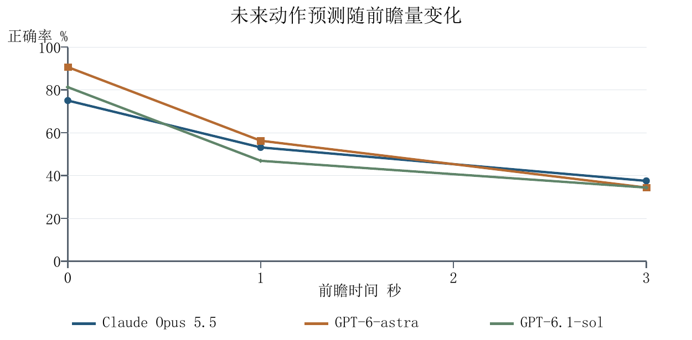

# Satori 复现与模型评测实验简报

日期：2026年10月18日（10月20日补充输入说明、问答示例和语义重评分）

本阶段围绕“理解用户所处环境、正在做什么、下一步可能做什么”开展实验。已搭建 Satori 方法原型并接入 Unity，完成七个模型在公开第一视角数据上的对比。当前结果是：**高层任务目标识别效果较好，未来动作预测还有明显下降；任务问答按意思评分最高约37%，涉及多人互动和反事实推理的问题仍然很弱。**

## 1. 跑了哪些实验

| 实验 | 数据与规模 | 给模型看的画面 | 测什么 |
|---|---|---|---|
| 任务目标识别 | GTEA，28个视频、7类目标 | 整段视频均分4段，每段取中间1帧 | 根据视频观察判断用户在完成什么任务 |
| 未来动作预测 | GTEA，32个目标事件，分别提前0、1、3秒预测，共96题 | 目标动作开始前的4帧，每秒1帧；提前1秒或3秒预测时，4帧整体再往前移1秒或3秒 | 根据之前的画面判断接下来发生的动作 |
| 任务相关问答 | EgoTaskQA，200题，涉及189个视频 | 整段视频均分4段，每段取中间1帧，另附英文问题 | 回答关于人物、物体、动作和事件关系的问题 |
| 环境与动作识别 | Charades-Ego，32段视频 | 整段视频均分8段，每段取中间1帧 | 识别场景和动作，比较 Mage-VL 与 GPT |
| Satori 流程演示 | EgoDex清洁短片，6个采样时刻 | 每个时刻取截至当时最近的1至4帧 | 验证环境理解、目标提议、下一步预测、进度检查和指导生成能否串起来 |

前三项为主实验，每个模型324题，七个模型累计2268个模型—样本结果，其中包含此前已完成的 Mage-VL 和 VideoChat3-4B 结果。模型看到的是按时间顺序排列、带时间戳的关键帧，**不是连续视频流**：本实验以图片输入调用 GPT 和 Claude，统一使用关键帧后，七个模型收到的图片、时间戳和问题完全相同；VideoChat3 和 Dispider 这类视频模型也接收这同样的4帧（Dispider 把每帧重复4次，填满它的16个输入位置），但各模型内部的预处理和调用方式不同。图片保持原始分辨率，不含音频和 IMU。目标识别从7类厨房任务中选一个（如做咖啡、做奶酪三明治、泡甜茶），动作预测从73种动作中选一个（如 take (bread)、open (honey)），候选表每题相同；问答则用英文短语自由作答。标准答案和视频文件名不进入请求，评分在推理结束后用数据集标准答案进行。

目标识别和动作预测报告准确率。问答的正式分数是**字面匹配率**：统一大小写、标点、英文冠词和空白后，答案须与标准答案完全一致。接口失败、输出格式不合要求和弃答（模型按要求返回空答案，表示证据不足）都计入总题数、按错误计。问答另做了一次语义重评分作为补充（见第3节），正式分数仍以字面匹配为准。

## 2. 七模型主实验结果

| 模型 | 目标识别，28题 | 动作预测，96题 | 任务问答，200题（字面匹配） |
|---|---:|---:|---:|
| Claude Opus 5.5 | **89.29%（25/28）** | 55.21%（53/96） | **22.50%（45/200）** |
| GPT-6-astra | 67.86%（19/28） | **60.42%（58/96）** | 19.50%（39/200） |
| GPT-6.1-sol | **89.29%（25/28）** | 54.17%（52/96） | 17.50%（35/200） |
| GPT-5.6-sol | 67.86%（19/28） | 13.54%（13/96）* | 全部接口失败，无法评价 |
| Mage-VL | 53.57%（15/28） | 6.25%（6/96） | 2.00%（4/200） |
| VideoChat3-4B | 32.14%（9/28） | 5.21%（5/96） | 4.00%（8/200） |
| Dispider | 未获得合格输出 | 未获得合格输出 | 未获得合格输出 |

*GPT-5.6-sol动作预测中有53次调用失败，问答200题全部接口失败，其低分不能直接解释为模型能力弱。Dispider的输出未满足本轮评分格式要求，不能解释为视觉能力为零。Mage-VL和VideoChat3-4B也受到接口或输出格式问题影响。*

模型名称按简称展示。实际主实验中 Claude 使用 high，GPT 未显式指定推理档位；因此这里比较的是各模型在当前接入配置下的表现，未完全控制内部推理预算。GPT 名称沿用第三方接口的路由别名，底层权重未独立核验。部分 GPT 结果因限流分批续跑，只补跑从未尝试过的题目，已尝试的结果原样保留。Claude 的原始采集脚本曾把309个合法回答误判为失败，表中 Claude 结果是按原始返回事件离线重新解析得到的，没有重新调用模型。

## 3. 效果说明

**任务目标识别较好。** Claude和GPT-6.1-sol均答对25/28个视频，达到89.29%。不过这里使用了覆盖完整视频的4帧，主要说明模型能概括整段任务，尚不能证明任务刚开始时就能识别目标。

**预测距离越远，准确率越低。** 三个表现较好的模型在不同预测时距下的结果如下，每一格均为答对题数/32：

| 模型 | 0秒 | 提前1秒 | 提前3秒 |
|---|---:|---:|---:|
| Claude Opus 5.5 | 24/32 | 17/32 | 12/32 |
| GPT-6-astra | 29/32 | 18/32 | 11/32 |
| GPT-6.1-sol | 26/32 | 15/32 | 11/32 |

0秒条件的最后观察帧也早于目标动作起点。结果表明，判断紧接当前观察的动作相对容易，提前更久判断用户意图仍有困难。

**任务问答按字面评分明显偏低，真正的短板在多人互动和反事实推理。** 按字面匹配，最高分为Claude的22.50%，而所有题固定回答“no”的简单基线就有18%；Claude在68道是非题中答对43题，在132道查询题中仅答对2题。逐题检查发现，查询题的标准答案使用数据集内部标签词，例如 `bottle-water`、`watermelon1`、`poweredness`，意思正确的自由作答也会被判错。下面是一道真实题目（引自 EgoTaskQA 公开数据）：

| 项目 | 内容 |
|---|---|
| 画面 | 4张客厅关键帧：前3帧电视开着，第3帧画面下方能看到一只手，第4帧电视已关 |
| 问题 | How did the person changed the poweredness of the last object that has status change in the video?（这个人是怎么改变视频中最后一个发生状态变化的物体的通电状态的？） |
| 标准答案 | `Turn off TV with remote` |
| Claude 回答 | `turned off the TV using the remote control` |
| 判分 | 字面匹配判错；语义重评分判为等价 |

为此补充了一次语义重评分：

| 模型 | 字面匹配 | 语义等价 | 含部分正确 |
|---|---:|---:|---:|
| Claude Opus 5.5 | 22.50%（45/200） | **36.50%（73/200）** | 40.00%（80/200） |
| GPT-6-astra | 19.50%（39/200） | 29.50%（59/200） | 34.00%（68/200） |
| GPT-6.1-sol | 17.50%（35/200） | 26.50%（53/200） | 31.00%（62/200） |
| Mage-VL | 2.00%（4/200） | 4.00%（8/200） | 8.00%（16/200） |
| VideoChat3-4B | 4.00%（8/200） | 6.00%（12/200） | 8.50%（17/200） |

提升全部来自查询题，例如Claude从2/132升到30/132；是非题不受影响。按意思评分后，数据集归为多人互动类的13道题（多数问“另一个人在做什么”），三个API模型仍全部答错；40道反事实题中，Claude也只从11题升到12题。这两类才是当前真正的短板。四帧观察可能缺少关键证据，但还不能把低分全部归因于帧数。

语义重评分由三个独立的Claude Haiku 5.5判分代理盲评（看不到模型名称），只比较答案文字的含义、不看视频，按多数票定标签。真实答案中三票完全一致的占92%（Fleiss κ 0.86），40个故意配错的对照答案无一被判为正确；之后又做了正反两向的复核，复核分歧、标签不一致和抽查发现的13项由主控 AI（主会话中的 Claude Opus 5.5，不是人工）按细则裁决。这是看到结果后追加的补充分析，全程没有人工标注，也不能与原论文按固定答案词表分类的分数直接比较。

**当前本地模型配置整体落后于表现较好的API模型。** Mage-VL和VideoChat3-4B的动作预测、任务问答分数较低。除了理解能力，输入适配和结构化输出稳定性也需要改进；Dispider本次尚未形成可用的评分输出。

## 4. 其他已完成实验

### Charades-Ego环境与动作识别

在固定32段视频、每段8帧的条件下，动作识别结果如下，micro-F1综合考虑动作识别的精确率和召回率，越高越好：

| 模型或基线 | 动作识别 micro-F1 |
|---|---:|
| GPT-5.6-luna | 31.21% |
| 固定训练频率基线 | 17.82% |
| Mage-VL | 16.42% |

GPT优于Mage，但GPT动作召回率也只有19.13%，仍存在大量漏检。在两个模型都成功返回的28段视频上，场景识别均答对15段。这个实验说明，识别场景和识别具体动作的难度不同，不能用场景识别结果代替任务理解效果。该实验独立于上面的七模型主实验。

### Satori与Unity流程演示

用真实清洁视频完成了6个时刻的输入，窗口逐步从1帧增加到4帧，得到15个阶段响应。环境与行为理解、目标提议、下一步预测、进度检查、文字指导和指导缓存均已运行，结果可在Unity中回放查看。

本次验证了流程可运行，但最后步骤仍处于执行状态，没有完成整项任务，也没有独立步骤标签来计算准确率。完整任务交互、真实眼镜相机与IMU融合、提示时机和用户体验仍待验证。

## 5. 当前结论与下一步

目前已完成**Satori方法原型、Unity回放展示，以及公开数据上的模块benchmark**。现有结果支持继续研究时序任务理解：模型较擅长概括高层目标，但具体动作、较远未来预测，以及涉及多人互动和反事实推理的问答仍有明显不足。当前评测尚未完全对齐原论文协议，不能据此宣称完整复现Satori的系统效果。

下一步优先推进三项工作：

1. **补完整任务闭环。** 在Unity中支持确认目标、拒绝错误建议、完成步骤和重做步骤，并用独立标注评价整段任务。
2. **比较时序输入和记忆。** 固定模型与其他设置，比较不同帧数、时间窗口和事件记忆，检查是否改善动作漏检和任务问答。
3. **验证主动帮助的实际收益。** 测量提示是否准确、是否及时以及用户等待时间；之后再加入真实同步IMU与眼镜采集。
